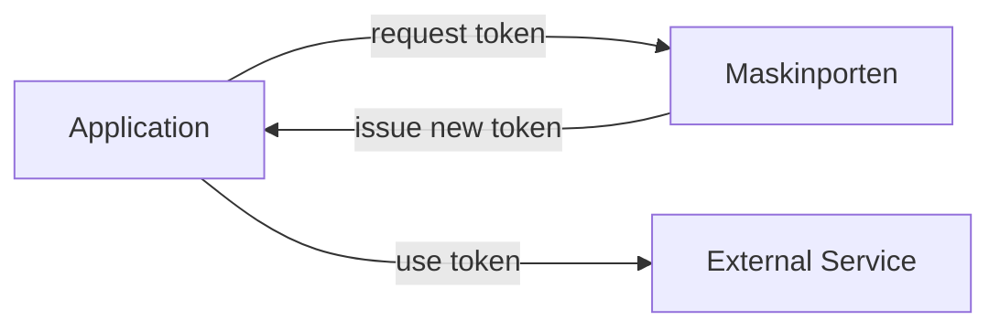

# pymaskinporten

<!-- badges start-->

[](https://pypi.org/project/pymaskinporten/)
[](.github/workflows/ci.yml)
[](release-please-config.json)
[](https://github.com/norwegianveterinaryinstitute/pymaskinporten/actions/workflows/docs.yml)
[](https://github.com/norwegianveterinaryinstitute/pymaskinporten/actions/workflows/publish.yml)
[](https://github.com/norwegianveterinaryinstitute/pymaskinporten/issues?q=is%3Apr%20is%3Aopen%20author%3Aapp%2Fdependabot)
[](https://github.com/astral-sh/uv)
[](https://github.com/astral-sh/ruff)
[](https://conventionalcommits.org)
[](https://opensource.org/license/apache-2.0)
<!-- badges end-->

This is a python package to request a token from [Maskinporten](https://samarbeid.digdir.no/maskinporten/dette-er-maskinporten/96) - the Norwegian 
national access control solution for businesses that exchange data.



## Installation

```bash
pip install pymaskinporten
```

Optional extras add the secret-store SDKs and the demo app:

| Extra        | Adds                                |
|--------------|-------------------------------------|
| `azure`      | Azure Key Vault loader              |
| `databricks` | Databricks secrets loader           |
| `aws`        | AWS Secrets Manager loader          |
| `gcp`        | Google Secret Manager loader        |
| `web`        | The `pymaskinporten-web` demo app   |

For example: `pip install "pymaskinporten[azure,web]"`.

## Example usage

This assumes you have created the integration at Digdir and have its private key (PEM), key ID,
client ID and scope.

By default the credentials are read from the environment variables `PRIVATE_KEY`,
`MASKINPORTEN_CLIENT_ID`, `KID` and `SCOPE`:

```python
from pymaskinporten import request_maskinporten_token

access_token, expires_in = request_maskinporten_token("test")  # or "prod"
```

`api_env` must be `"test"` or `"prod"`; anything else raises `ValueError`. A failed token request
raises `MaskinportenTokenError`.

### Secret stores

`load_config()` can also read the credentials from a secret store. Pass the result with `config=`:

```python
from pymaskinporten import load_config, request_maskinporten_token

config = load_config("azure", key_vault_uri="https://my-vault.vault.azure.net/")
access_token, expires_in = request_maskinporten_token("prod", config=config)
```

| Store                 | Call                                                         | Install                              |
|-----------------------|--------------------------------------------------------------|--------------------------------------|
| Azure Key Vault       | `load_config("azure", key_vault_uri="https://...")`          | `pip install "pymaskinporten[azure]"` |
| Databricks secrets    | `load_config("databricks", secret_scope="maskinporten")`     | `pip install "pymaskinporten[databricks]"` |
| AWS Secrets Manager   | `load_config("aws", region="eu-north-1")`                    | `pip install "pymaskinporten[aws]"`  |
| Google Secret Manager | `load_config("gcp", project_id="my-project")`                | `pip install "pymaskinporten[gcp]"`  |

Each store signs in with its SDK's default credentials: `DefaultAzureCredential` for Azure,
the Databricks runtime for Databricks, boto3's credential chain for AWS (`region` falls back to
boto3's configured region), and Application Default Credentials for Google (the latest secret
version is read).

Secret stores use dashes in the names, because Key Vault doesn't allow underscores:

| Credential        | Environment variable     | Secret name              |
|-------------------|--------------------------|--------------------------|
| Private key (PEM) | `PRIVATE_KEY`            | `PRIVATE-KEY`            |
| Client ID         | `MASKINPORTEN_CLIENT_ID` | `MASKINPORTEN-CLIENT-ID` |
| Key ID            | `KID`                    | `KID`                    |
| Scope             | `SCOPE`                  | `SCOPE`                  |

### Name prefixes

`prefix` is put in front of every environment variable or secret name, so test and prod
credentials can live side by side:

```python
# Reads PROD_PRIVATE_KEY, PROD_KID, ...
load_config(prefix="PROD_")

# Reads maskinporten/prod/PRIVATE-KEY, ...
load_config("aws", prefix="maskinporten/prod/")
```

The prefix is used as-is, so use only characters the source allows (besides letters and digits):

- Environment variables: `_`
- Azure Key Vault: `-`
- Google Secret Manager: `-` `_`
- Databricks: `-` `_` `.`
- AWS Secrets Manager: `-` `_` `/` `+` `=` `.` `@`

### Passing credentials directly

To use credentials from anywhere else, build them yourself and pass them with `config=`:

```python
from pymaskinporten import MaskinportenSecrets, request_maskinporten_token

secrets = MaskinportenSecrets(
    PRIVATE_KEY=open("private_key.pem").read(),
    MASKINPORTEN_CLIENT_ID="your-client-id",
    KID="your-kid",
    SCOPE="your-scope",
)
access_token, expires_in = request_maskinporten_token("prod", config=secrets)
```

### Using a `.env` file

By default, `load_config()` reads environment variables only. To keep the credentials in a `.env`
file, install `python-dotenv` (`pip install python-dotenv`) and load it before requesting a
token:

```python
from dotenv import load_dotenv

load_dotenv()
```

The demo app below does this for you.

## Docker container 

To test the library in a web browser, use the `pymaskinporten-web` demo app (a `flask` app).
Run it locally with `pip install "pymaskinporten[web]"` and `pymaskinporten-web`, or use the
Docker image:

```bash
cat > .env <<EOF
MASKINPORTEN_CLIENT_ID=your-client-id
KID=your-kid
SCOPE=your-scope
EOF

docker run -p 127.0.0.1:5000:5000 --env-file .env \
  -e PRIVATE_KEY="$(cat private_key.pem)" \
  ghcr.io/norwegianveterinaryinstitute/pymaskinporten:main
```

`--env-file` keeps quotes as part of the value and doesn't support multi-line values, so leave
the values unquoted and pass the PEM key with `-e`. In PowerShell, use
`-e PRIVATE_KEY="$(Get-Content -Raw private_key.pem)"`.

Then open <http://127.0.0.1:5000>.

> [!WARNING]
> The demo app is for local testing only. Its `/token` endpoint returns real access tokens
> (including prod) without any authentication. `pymaskinporten-web` listens on `127.0.0.1` by
> default, but inside the Docker image it listens on all interfaces, so always publish the port
> with the `127.0.0.1:` prefix as shown above.
