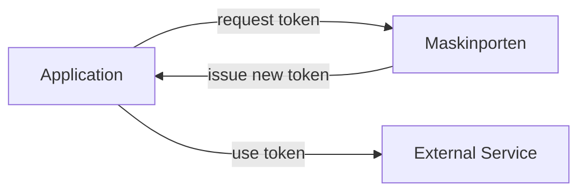

# pymaskinporten

<!-- badges start-->

[](https://pypi.org/project/pymaskinporten/)
[](.github/workflows/ci.yml)
[](release-please-config.json)
[](https://github.com/norwegianveterinaryinstitute/pymaskinporten/actions/workflows/docs.yml)
[](https://github.com/norwegianveterinaryinstitute/pymaskinporten/actions/workflows/publish.yml)
[](https://github.com/norwegianveterinaryinstitute/pymaskinporten/issues?q=is%3Apr%20is%3Aopen%20author%3Aapp%2Fdependabot)
[](https://github.com/astral-sh/uv)
[](https://github.com/astral-sh/ruff)
[](https://conventionalcommits.org)
[](https://opensource.org/license/apache-2.0)
<!-- badges end-->

This is a python package to request a token from [Maskinporten](https://samarbeid.digdir.no/maskinporten/dette-er-maskinporten/96) - the Norwegian 
national access control solution for businesses that exchange data.



## Example usage

This assumes that: 
1. You have created the integration on digidir.no and,
2. You have set the necessary environment variables for your API credentials.

```python
# set environment variables for your API
import os

os.environ["KID"] = "your_kid"
os.environ["PRIVATE_KEY"] = "your_private_key"
os.environ["MASKINPORTEN_CLIENT_ID"] = "your_client_id"
os.environ["SCOPE"] = "your_scope"

# get the access token
from pymaskinporten.request_token import request_maskinporten_token

access_token, expires_in = request_maskinporten_token("test")
print(f"Access Token: {access_token}")
print(f"Expires In: {expires_in} seconds")
```

## Docker container 

If you want to test the library through a web browser the image opens a `flask` app:

```bash
cat > .env <<EOF
MASKINPORTEN_CLIENT_ID=your-client-id
KID=your-kid
SCOPE=your-scope
EOF

docker run -p 127.0.0.1:5000:5000 --env-file .env \
  -e PRIVATE_KEY="$(cat private_key.pem)" \
  ghcr.io/norwegianveterinaryinstitute/pymaskinporten:main
```

`--env-file` keeps quotes as part of the value and doesn't support multi-line values, so leave
the values unquoted and pass the PEM key with `-e`. In PowerShell, use
`-e PRIVATE_KEY="$(Get-Content -Raw private_key.pem)"`.

Then open <http://127.0.0.1:5000>.

> [!WARNING]
> The demo app is for local testing only. Its `/token` endpoint returns real access tokens
> (including prod) without any authentication. `maskinporten-web` listens on `127.0.0.1` by
> default, but inside the Docker image it listens on all interfaces, so always publish the port
> with the `127.0.0.1:` prefix as shown above.
